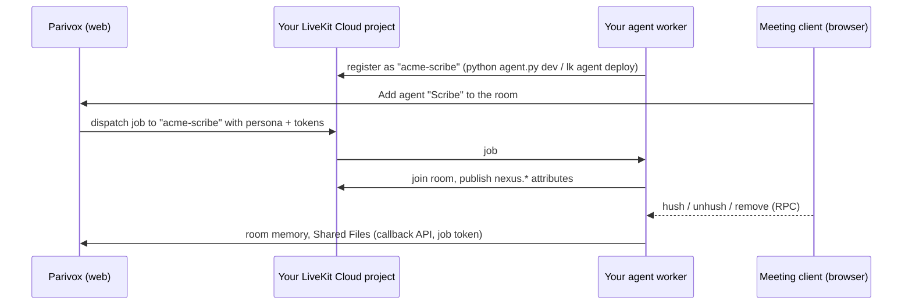

# Parivox agents on your own LiveKit

Build a voice agent with [LiveKit Agents](https://docs.livekit.io/agents/), run it on **your own LiveKit Cloud project** (or your laptop), and add it to meetings in [Parivox](https://workspace.parivox.net) Workspace rooms like any built-in agent.

This repo has two things:

- **`parivox_agents`**, a small Python package that makes a LiveKit agent behave like a Parivox agent: it shows up correctly on the meeting tile, obeys the host's hush and remove buttons, follows whoever is speaking, goes quiet on request, can page a human, and calls back into Parivox for room memory and Shared Files.
- **Room Scribe** ([`examples/room_scribe`](examples/room_scribe/agent.py)), a meeting note-taker that remembers the room. It's about 200 lines, and it uses each integration point once.

> **Status: preview.** Self-hosted agents work in rooms that run on your own LiveKit project (see [How it fits together](#how-it-fits-together)). The callback API will move to a versioned `/api/v1/agent` surface; the `ParivoxClient` method names stay the same.

## How it fits together



1. In Parivox **Settings → LiveKit Cloud Configuration**, you turn on **Use my LiveKit config** and enter your project's URL, API key and secret. Your rooms now run on your project.
2. Your worker registers with that project under a name you choose, such as `acme-scribe`.
3. In the Parivox agent editor, you create an agent and set **Runs on → Self-hosted worker name** to `acme-scribe`. Its name, prompt, greeting and skills are still edited in Parivox.
4. When someone adds the agent to one of your rooms, Parivox dispatches a job to your worker. The job carries the persona and short-lived tokens for calling back into Parivox. `ParivoxRoom` handles the rest.

Your agent's code, models and keys never leave your infrastructure. Parivox only sends the job and serves the callbacks.

## Quickstart (10 minutes)

You need Python 3.11+, [uv](https://docs.astral.sh/uv/), a [LiveKit Cloud](https://cloud.livekit.io) project, and a Parivox account with developer access (the LiveKit settings below appear only for developer accounts).

**1. Clone and configure.**

```bash
git clone https://github.com/parivox/parivox-agent.git
cd parivox-agent
uv sync --all-extras
cp examples/room_scribe/.env.example .env
```

Fill in `LIVEKIT_URL`, `LIVEKIT_API_KEY` and `LIVEKIT_API_SECRET` from your LiveKit project (**Settings → Keys**). Room Scribe uses [LiveKit Inference](https://docs.livekit.io/agents/models/) for speech and the LLM, so it needs no other keys.

**2. Point Parivox at your LiveKit project.** In Parivox, open **Settings**, and under **LiveKit Cloud Configuration** turn on **Use my LiveKit config** and enter the same URL, key and secret.

**3. Register the agent in Parivox.** Open **Agents → New agent**, name it "Scribe", and under **Runs on** set **Self-hosted worker name** to `room-scribe-dev` (the default `AGENT_NAME` in `.env`). Optionally turn on **Escalate to Human** and enter your email, so the agent can page you.

If you use Parivox from an MCP client such as Claude, you can do this step with one tool call instead:

```json
create_agent { "agent": { "agentId": "scribe-dev", "name": "Scribe", "selfHostedAgentName": "room-scribe-dev" } }
```

**4. Run the worker.**

```bash
uv run examples/room_scribe/agent.py download-files   # once: the voice-activity model
uv run examples/room_scribe/agent.py dev
```

The worker connects out to LiveKit, so no tunnel or public address is needed.

**5. Try it.** Start a meeting in one of your Parivox rooms and add **Scribe**. Then:

- ask "Scribe, what does this room remember?";
- say "remember that the launch is May 3" (you need to own or co-own the room);
- tap **Summarize so far** on its tile;
- say "give us a minute", then "Okay Scribe" to bring it back;
- leave the meeting, and find **Meeting notes …md** in the room's Shared Files.

To run it in the cloud instead, see [docs/deploy.md](docs/deploy.md).

## Writing your own agent

```python
from livekit.agents import AgentServer, AgentSession, JobContext, cli
from parivox_agents import ParivoxAgent, ParivoxRoom

server = AgentServer()


class Helper(ParivoxAgent):
    def __init__(self, parivox: ParivoxRoom) -> None:
        super().__init__(parivox, instructions=parivox.job.persona.system_prompt or "You are helpful.")


@server.rtc_session(agent_name="acme-helper")
async def entrypoint(ctx: JobContext) -> None:
    parivox = ParivoxRoom(ctx)
    session = AgentSession(stt="deepgram/nova-3", llm="openai/gpt-4.1-mini", tts="cartesia/sonic-3")
    await parivox.start(session, Helper(parivox))


if __name__ == "__main__":
    cli.run_app(server)
```

| You get | From |
| --- | --- |
| The agent's name, prompt, greeting, skills and settings from the Parivox editor | `parivox.job.persona` |
| Tile presence, hush, unhush and remove | `parivox.start(...)` |
| Listening to whoever is speaking, ignoring transcribers and translators | `parivox.start(...)` |
| Quiet mode ("give us a minute" … "Okay Scribe") | on by default; `ParivoxRoom(ctx, quiet_mode=False)` to opt out |
| Handoff to a human | on when the agent has an Escalate to Human contact |
| Tap-to-say buttons on the tile | `await parivox.set_suggested_responses([...])` |
| Room memory and Shared Files | `parivox.client` ([docs/callback-api.md](docs/callback-api.md)) |
| Your provider keys stored in Parivox | `await ProviderKeys.load(parivox.job)` |
| Real-time translation | nothing to do: Parivox runs it beside your agent |

`ParivoxAgent` is an ordinary LiveKit `Agent`, so add `@function_tool` methods, other models, or anything else from LiveKit Agents.

## Documentation

- [Local development](docs/local-development.md): dev and production worker names, testing without Parivox.
- [Deploying](docs/deploy.md): `lk agent deploy`, secrets, and registering the agent.
- [Callback API](docs/callback-api.md): what the agent can do in Parivox, and as whom.
- [In-room protocol](docs/protocol.md): the attributes and RPCs between agent and meeting client, for porting to another language.

## Development

```bash
uv sync --all-extras
uv run pytest
uv run ruff check . && uv run ruff format --check .
```

The tests use fakes for LiveKit, so they need no server or keys. See [CONTRIBUTING.md](CONTRIBUTING.md).

## License

[MIT](LICENSE)
